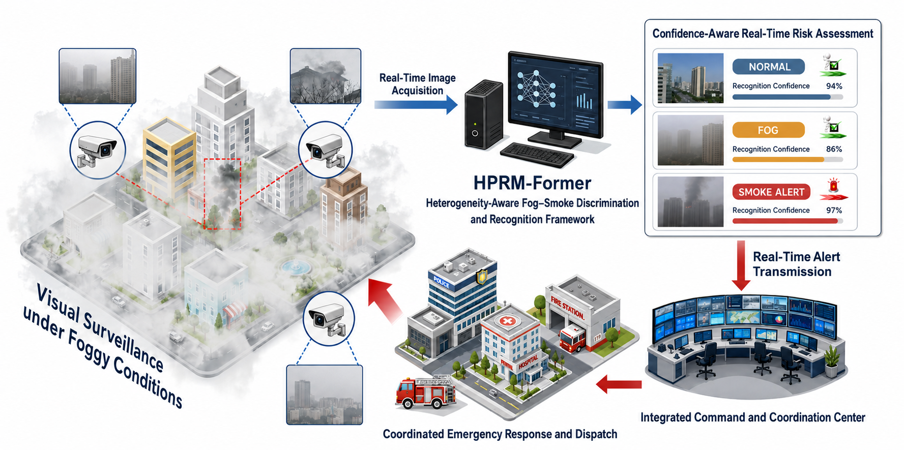

<div align="center">

# FSBench-40K

### Smoke detection under foggy conditions

A four-category image benchmark accompanying **HPRM-Former**

[Overview](#overview) · [Image examples](#image-examples) · [Data access](#data-access) · [Usage conditions](docs/DATA_USE_TERMS.md) · [Citation](#citation) · [中文说明](README_zh-CN.md)



*Conceptual application workflow. Displayed confidence values are illustrative.*

</div>

## Overview

FSBench-40K supports research on distinguishing smoke from fog and identifying their coexistence in a single image. The task is **image-level classification** into **Normal**, **Fog**, **Smoke** and **SmokeFog**. Its emphasis is the ambiguity between atmospheric fog, smoke and their overlapping visual appearance.

| Category | Visual state | Research role |
| :--- | :--- | :--- |
| **Normal** | Neither visible smoke nor fog | Background reference |
| **Fog** | Fog without visible smoke | Fog-related false-warning assessment |
| **Smoke** | Smoke without coexisting fog | Smoke-state classification |
| **SmokeFog** | Smoke coexisting with fog | Smoke detection under fog interference |

This repository provides the project introduction, representative images, application materials and access instructions. The complete research dataset is supplied separately following application review by the corresponding author.

## Image examples


*Rows from top to bottom: Normal, Fog, Smoke and SmokeFog. This figure illustrates the four categories; it is not a downloadable dataset release.*

## HPRM-Former

**A Heterogeneity-Aware Prototype Routing Transformer with Consensus-Disagreement Memory for Smoke Detection under Foggy Conditions**

Yao Wei, Haicheng Qu, Tong Gao, Hao Chen, and Cuiping Shi

HPRM-Former models regional variation, prototype-routing ambiguity and complementary information across feature stages:

| Component | Function |
| :--- | :--- |
| **RHASR** | Region Heterogeneity-Aware Scale Routing uses regional statistics and image-level priors to select spatially varying scale weights. |
| **ACPRM** | Ambiguity-Calibrated Prototype Routing Mixer constructs input-dependent prototypes and uses retrieval entropy and confidence to regulate local–prototype fusion. |
| **CDMF** | Consensus-Disagreement Memory Fusion combines cross-stage consensus, disagreement and compact memory constructed from the current image. |

The memory is rebuilt for each input image; it is not a persistent video memory.

## Data access

1. Read the [access guide](docs/ACCESS.md) and [data use conditions](docs/DATA_USE_TERMS.md).
2. Download and complete the **[fillable application PDF](forms/FSBench-40K_Data_Access_Application.pdf)**. Include the research purpose, approved users, storage plan and signatures.
3. Email the completed form from your institutional address, where available, to **[Haicheng Qu](mailto:quhaicheng@lntu.edu.cn)**. Suggested subject: `FSBench-40K Data Access Request — Institution — Applicant`.
4. After approval, obtain the dataset through the delivery instructions provided by the corresponding author. The package identifies the supplied release and its training, validation and test splits.

**Corresponding author:** Haicheng Qu  
**Institution:** School of Software, Liaoning Technical University  
**Email:** [quhaicheng@lntu.edu.cn](mailto:quhaicheng@lntu.edu.cn)

Please send completed forms by email rather than posting personal details or data links in GitHub issues. Requests are assessed using the stated research purpose, verifiable affiliation, data-handling plan and applicable source permissions.

## What accompanies an approved delivery

- The approved image archive and class definitions.
- A release identifier and release notes.
- Image identifiers and train / validation / test manifests.
- File checksums for integrity verification.
- Citation, source acknowledgements and applicable use conditions.

The delivery record, rather than the showcase figure, identifies the experimental dataset version. See the [release documentation](docs/RELEASES.md).

## Citation

When using FSBench-40K, cite the associated HPRM-Former manuscript and state the dataset release identifier. The manuscript is currently under review; the citation below does not imply journal acceptance.

```bibtex
@unpublished{wei2026hprmformer,
  title  = {A Heterogeneity-Aware Prototype Routing Transformer with Consensus-Disagreement Memory for Smoke Detection under Foggy Conditions},
  author = {Wei, Yao and Qu, Haicheng and Gao, Tong and Chen, Hao and Shi, Cuiping},
  year   = {2026},
  note   = {Manuscript under review}
}
```

The [citation file](CITATION.cff) will be updated when publication information is available. Respect any additional source citations included in the supplied release.

## Contact and corrections

For access, source attribution or dataset corrections, contact [quhaicheng@lntu.edu.cn](mailto:quhaicheng@lntu.edu.cn) with the release identifier and relevant image IDs. General documentation suggestions may be raised in the repository without uploading dataset images or completed application forms.
