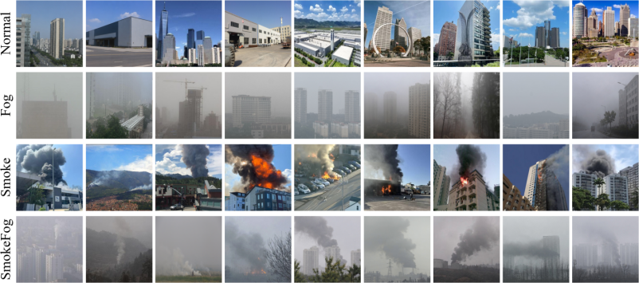

<div align="center">

# FSBench-40K

### Foggy Smoke Benchmark-40K

**A four-category image benchmark for smoke detection under foggy conditions**

[Overview](#overview) · [Image examples](#image-examples) · [Statistics and splits](#dataset-statistics-and-splits) · [Data access](#data-access) · [Citation](#citation) · [中文说明](README_zh-CN.md)

</div>

**FSBench-40K (Foggy Smoke Benchmark-40K)** supports image-level smoke detection under foggy conditions, with particular emphasis on distinguishing smoke from atmospheric fog and identifying their coexistence. It comprises four categories—**Normal, Fog, Smoke, and SmokeFog**—to support the evaluation of background discrimination, fog-related false warnings, and smoke detection under fog interference.

This repository provides the dataset overview, representative images, partition information, and research access materials. FSBench-40K accompanies our research on **[HPRM-Former](docs/HPRM_FORMER.md)**.


*Conceptual application workflow. Displayed confidence values are illustrative.*

## Overview

The benchmark addresses a **single-image, four-category classification task**. The categories distinguish the presence of visible smoke and atmospheric fog, with **SmokeFog** specifically representing their coexistence. This supports both four-category evaluation and analysis of smoke-related warning errors.

| Category | Visual state | Research role |
| :--- | :--- | :--- |
| **Normal** | Neither visible smoke nor fog | Background reference |
| **Fog** | Fog without visible smoke | Fog-related false-warning assessment |
| **Smoke** | Smoke without coexisting fog | Smoke-state classification |
| **SmokeFog** | Smoke coexisting with fog | Smoke detection under fog interference |

For image-level warning analysis, **Smoke and SmokeFog are positive**, while **Normal and Fog are negative**. Confusing Smoke with SmokeFog changes the four-category prediction but does not constitute a missed warning.

## Image examples



*Rows from top to bottom: Normal, Fog, Smoke and SmokeFog. The figure illustrates the visual categories; the full image archive is supplied through the data access process.*

## Dataset statistics and splits

The current manuscript reports **40,579 images** with a target **80% / 10% / 10%** training, validation and test split. The table below records that manuscript distribution; release-specific counts and image lists accompany the approved dataset package.

| Split | Normal | Fog | Smoke | SmokeFog | Total |
| :--- | ---: | ---: | ---: | ---: | ---: |
| Train | 8,290 | 7,304 | 8,815 | 8,053 | 32,462 |
| Validation | 1,036 | 913 | 1,101 | 1,006 | 4,056 |
| Test | 1,037 | 913 | 1,103 | 1,008 | 4,061 |
| **Total** | **10,363** | **9,130** | **11,019** | **10,067** | **40,579** |

- **Training:** model parameter learning.
- **Validation:** configuration selection and checkpoint selection.
- **Test:** final evaluation after the model and evaluation settings have been fixed.

Use the supplied fixed splits for benchmark comparisons. The release documentation records the partition protocol and available source-group information. See [split documentation](docs/SPLITS.md) for the inventory fields, source-group handling and evaluation conventions.

## Dataset organisation and versions

The image package follows this class-folder convention:

```text
FSBench-40K/
├── train/
│   ├── Normal/
│   ├── Fog/
│   ├── Smoke/
│   └── SmokeFog/
├── val/
│   ├── Normal/
│   ├── Fog/
│   ├── Smoke/
│   └── SmokeFog/
└── test/
    ├── Normal/
    ├── Fog/
    ├── Smoke/
    └── SmokeFog/
```

Each approved delivery is accompanied by a **release identifier**, **class mapping**, **train / validation / test manifests**, **integrity checksums**, and **release notes**. The manifest connects each image to its category and subset. Source-group identifiers and attribution are included where established.

The complete images are provided separately by the corresponding author. This repository hosts the presentation and access materials; [release documentation](docs/RELEASES.md) explains how to identify the version used in an experiment.

## Data access

1. Read the [access guide](docs/ACCESS.md) and [data use conditions](docs/DATA_USE_TERMS.md).
2. Download and complete the **[fillable application PDF](forms/FSBench-40K_Data_Access_Application.pdf)**. Include the research purpose, approved users, storage plan and signatures.
3. Email the completed form from your institutional address, where available, to **[Haicheng Qu](mailto:quhaicheng@lntu.edu.cn)**. Suggested subject: `FSBench-40K Data Access Request — Institution — Applicant`.
4. After approval, obtain the dataset and its fixed version and split records through the delivery instructions provided by the corresponding author.

**Corresponding author:** Haicheng Qu  
**Institution:** School of Software, Liaoning Technical University  
**Email:** [quhaicheng@lntu.edu.cn](mailto:quhaicheng@lntu.edu.cn)

Please send completed forms by email rather than posting personal details or data links in GitHub issues. Requests are assessed using the stated research purpose, verifiable affiliation, data-handling plan and applicable source permissions.

## Associated paper

**A Heterogeneity-Aware Prototype Routing Transformer with Consensus-Disagreement Memory for Smoke Detection under Foggy Conditions**

Yao Wei, Haicheng Qu, Tong Gao, Hao Chen, and Cuiping Shi

HPRM-Former is the associated classification framework for smoke detection under foggy conditions. Its model overview and three component descriptions are provided on the **[HPRM-Former page](docs/HPRM_FORMER.md)**.

## Citation

When using FSBench-40K, cite the associated HPRM-Former manuscript and state the dataset release identifier. The manuscript is currently under review; publication details will be updated when available.

```bibtex
@unpublished{wei2026hprmformer,
  title  = {A Heterogeneity-Aware Prototype Routing Transformer with Consensus-Disagreement Memory for Smoke Detection under Foggy Conditions},
  author = {Wei, Yao and Qu, Haicheng and Gao, Tong and Chen, Hao and Shi, Cuiping},
  year   = {2026},
  note   = {Manuscript under review}
}
```

The [citation file](CITATION.cff) provides machine-readable citation information. Respect any additional source citations included in the supplied release.

## Contact and corrections

For access, source attribution or dataset corrections, contact [quhaicheng@lntu.edu.cn](mailto:quhaicheng@lntu.edu.cn) with the release identifier and relevant image IDs. General documentation suggestions may be raised in the repository without uploading dataset images or completed application forms.
