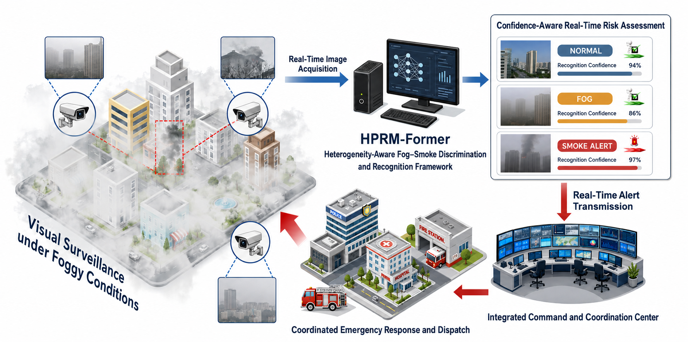
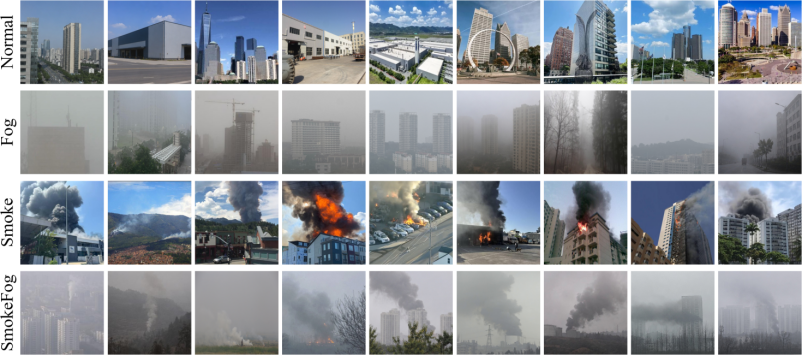

# FSBench-40K

### Foggy Smoke Benchmark-40K

**面向雾环境下烟雾检测的四分类图像基准数据集**

[English](README.md) · [数量与划分](#数量与划分) · [申请数据](#获取方式) · [数据申请表](forms/FSBench-40K_Data_Access_Application.pdf)

**FSBench-40K** 是 **Foggy Smoke Benchmark-40K** 的简称，面向雾环境下的图像级烟雾检测，重点关注烟与大气雾的区分及二者共存时的判别。数据集包含 **Normal、Fog、Smoke 和 SmokeFog** 四个类别，用于评价正常背景判别、雾干扰引起的误报以及雾中烟雾检测能力。

本仓库提供数据集介绍、代表性图像、划分说明和研究申请材料，与 **[HPRM-Former](docs/HPRM_FORMER.md)** 研究配套。



图中为概念性应用流程，所示置信度用于示意。

## 任务与类别

基准任务为单幅图像的四分类，根据可见烟雾和大气雾的状态区分四类图像，尤其关注烟与雾共存的 SmokeFog 类别。

| 类别 | 图像状态 | 评价作用 |
| :--- | :--- | :--- |
| **Normal** | 无可见烟雾和大气雾 | 正常背景参照 |
| **Fog** | 有雾，无可见烟雾 | 雾干扰下的误报评价 |
| **Smoke** | 有烟，无共存的大气雾 | 烟雾状态分类 |
| **SmokeFog** | 烟与大气雾共存 | 雾干扰下的烟雾检测 |

进行图像级预警评价时，**Smoke 与 SmokeFog 为正类，Normal 与 Fog 为负类**。Smoke 与 SmokeFog 之间的相互误判属于四分类错误，但不计为漏报。

## 代表性图像



上图各行依次为 Normal、Fog、Smoke 和 SmokeFog。完整图像通过数据申请流程提供。

## 数量与划分

当前论文报告 **40,579 张图像**，训练、验证与测试的目标比例为 **80% / 10% / 10%**。下表列出当前稿件的类别与划分数量；获批交付版本的具体数量与图像清单随数据包提供。

| Split | Normal | Fog | Smoke | SmokeFog | Total |
| :--- | ---: | ---: | ---: | ---: | ---: |
| Train | 8,290 | 7,304 | 8,815 | 8,053 | 32,462 |
| Validation | 1,036 | 913 | 1,101 | 1,006 | 4,056 |
| Test | 1,037 | 913 | 1,103 | 1,008 | 4,061 |
| **Total** | **10,363** | **9,130** | **11,019** | **10,067** | **40,579** |

- **训练集（train）**：用于学习模型参数。
- **验证集（val）**：用于配置选择和最佳检查点选择。
- **测试集（test）**：模型与评价设置固定后，用于最终评价。

开展基准比较时使用随数据提供的固定划分。版本记录说明划分协议和已建立的来源分组信息，清单字段与同源分组原则见[划分说明](docs/SPLITS.md)。

## 数据组织与版本

图像数据采用如下类别文件夹组织方式：

```text
FSBench-40K/
├── train/
│   ├── Normal/
│   ├── Fog/
│   ├── Smoke/
│   └── SmokeFog/
├── val/
│   ├── Normal/
│   ├── Fog/
│   ├── Smoke/
│   └── SmokeFog/
└── test/
    ├── Normal/
    ├── Fog/
    ├── Smoke/
    └── SmokeFog/
```

获批交付时同时提供版本编号、类别映射、训练／验证／测试清单、完整性校验和与版本说明。清单记录图像所属类别和集合；已建立的来源分组与来源说明一并保留。

完整图像由通讯作者另行提供，本仓库发布展示内容与申请材料。版本记录方式见[版本说明](docs/RELEASES.md)。

## 获取方式

1. 阅读[申请指南](docs/ACCESS.md)与[使用要求](docs/DATA_USE_TERMS.md)。
2. 下载并填写[可填写的申请表 PDF](forms/FSBench-40K_Data_Access_Application.pdf)，注明研究目的、使用人员、用途与数据保管方案，并完成签字。
3. 将申请表发送至通讯作者 **Haicheng Qu（[quhaicheng@lntu.edu.cn](mailto:quhaicheng@lntu.edu.cn)）**，优先使用机构邮箱。
4. 经审核同意后，由通讯作者提供完整数据及其固定版本、类别和训练／验证／测试划分说明。

通讯作者单位：**School of Software, Liaoning Technical University**。请通过邮件提交申请，勿在公开 Issue 中上传填写后的申请表。

## 主要使用要求

1. 仅在获批的研究目的、项目和使用期限内使用；商业、产品开发或实际业务用途需另行说明并获得书面许可。

2. 仅限申请人及获批团队成员访问；新增成员、负责人或机构变更应先更新申请。

3. 如实填写身份、机构及项目资料，优先使用机构邮箱；没有机构邮箱时提供可核实的研究身份信息。

4. 使用受访问控制的存储，保护下载链接和备份；外部云服务或第三方处理平台应在申请中说明。

5. 不向未获批人员提供数据包、逐图副本或访问链接，不建立未经允许的公开镜像；原始第三方许可已经赋予的权利不受此项限制。

6. 保留来源说明，遵守交付清单中的第三方条件；本项目不授予其无权授予的版权许可。

7. 按交付的引用信息注明数据集、关联论文及必要的原始来源，并报告所用数据版本。

8. 基准比较保留图像编号和划分清单，测试集不参与选模型；自定义划分、额外训练数据、重标注及预处理变化应明确报告。

9. 可以正常发表汇总结果和模型研究；发布样例原图或包含可还原原图的衍生数据前检查相应许可，不以结果有利或共同署名作为访问条件。

10. 仅开展声明的视觉研究，不识别或联系图中个人，不提取与研究无关的个人信息。

11. 发现重复、标签、来源权利或数据暴露问题时，提供版本和图像编号反馈，并记录实验采用的本地修订。

12. 研究之外的使用应自行验证适用性；数据访问不构成对模型或实际火灾预警系统的认证。

13. 项目目的、成员、机构或期限变化时申请更新；期满按书面批准记录处理保留、延期或删除。

14. 申请表私下发给通讯作者，仅用于审核和访问管理，不在公开GitHub Issue中提交个人信息。

## 相关论文

**A Heterogeneity-Aware Prototype Routing Transformer with Consensus-Disagreement Memory for Smoke Detection under Foggy Conditions**

Yao Wei, Haicheng Qu, Tong Gao, Hao Chen, and Cuiping Shi

HPRM-Former 是与本数据集配套的烟雾检测分类框架，模型结构与三个核心模块的说明见[模型介绍页面](docs/HPRM_FORMER.md)。

## 引用与联系

完整引用格式见[英文首页](README.md#citation)。当前采用审稿中稿件的引用信息，发表后更新正式出版信息。使用数据时请同时报告交付版本编号，并遵循交付材料中的来源引用要求。数据访问、来源说明或更正事宜请联系 [quhaicheng@lntu.edu.cn](mailto:quhaicheng@lntu.edu.cn)。
